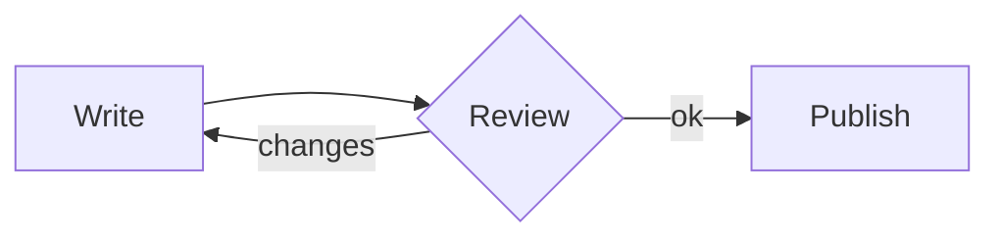
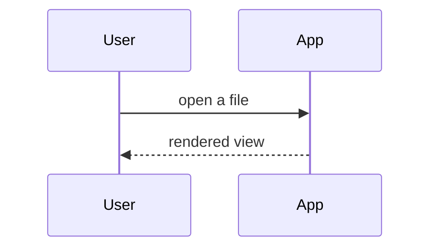

# Diagrams and formulas

Mermaid draws diagrams, KaTeX typesets maths — both render live in Reading, Split and Live view. Back to [[00 Welcome]].

## Flowchart



## Sequence diagram



## Inline formula

```markdown
The area of a circle is $A = \pi r^2$.
```

The area of a circle is $A = \pi r^2$.

## Block formula

```markdown
$$
\sum_{i=1}^{n} i = \frac{n(n+1)}{2}
$$
```

$$
\sum_{i=1}^{n} i = \frac{n(n+1)}{2}
$$

## Formula library

KaTeX shows a formula; a calculation between `{=` and `=}` computes one. The basic maths functions and constants such as `round` and `pi()` calculate in every working mode. Ready-made formulas for dew point and humidity, financial mathematics, percentages, unit conversion, the body mass index and physical constants come from the extension "Formula library" (File → Settings → Extensions), which is switched on in the Full working mode; while it is off, such a formula shows a warning sign with the notice "Formula library switched off". The manual page "Formula library" lists every formula with its arguments, units, source and valid range.

```markdown
Circle {= round(pi() * 2, 2) =}, dew point {= round(humidity.dewpoint(20, 50), 1) =} °C, monthly payment {= round(finance.pmt(0.08/12, 10, 10000), 2) =}, body temperature {= round(unit.fahrenheittocelsius(98.6), 1) =} °C
```

Circle {= round(pi() * 2, 2) =}, dew point {= round(humidity.dewpoint(20, 50), 1) =} °C, monthly payment {= round(finance.pmt(0.08/12, 10, 10000), 2) =}, body temperature {= round(unit.fahrenheittocelsius(98.6), 1) =} °C

Attachments are next: [[10 Attachments]].
