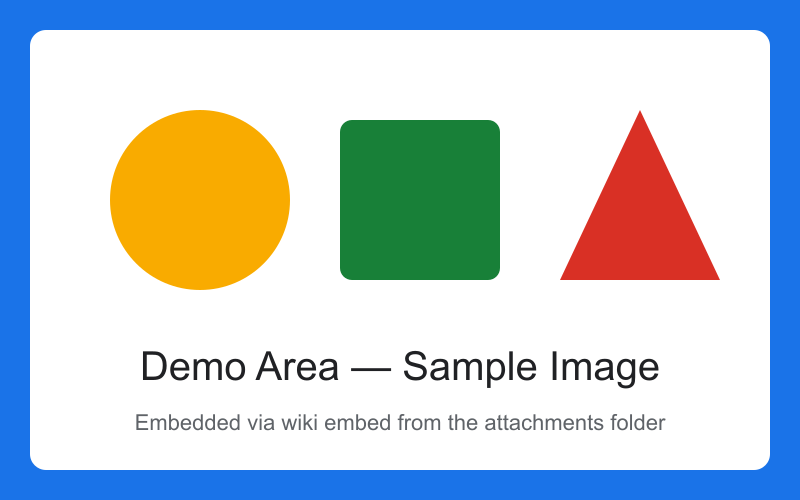

# A presentation

The last stop is a slide deck. This page is an ordinary Markdown file: the flag `presentation: true` in its front matter makes it a presentation.

Press `Ctrl+8` (View → Slides) to see it slide by slide, then `F5` for the slide show. `Esc` ends it.

%% Speaker note: welcome everybody and say **what the deck is about**. %%

---

# One rule, one new slide

A line of three hyphens with a blank line before it starts the next slide.

***

Three asterisks, like the line above, stay a rule **on** the slide.

<!-- Speaker note: HTML comments are notes as well, and they stay notes in other slide tools too. -->

---

# Step by step

In the slide show, items written with an asterisk appear one at a time:

* Press the right arrow once for each item
* Nested items are steps of their own
  * like this one
* Only after the last item comes the next slide

- Items written with a hyphen are there at once.

%% Speaker note: reveal the items _one by one_ and pause after each. %%

---

<!-- _backgroundColor: "#fff3bf" -->

# A slide of its own

The comment `<!-- _backgroundColor: … -->` on this slide gives it its own background. The underscore means: this slide only. The next slide is back to the theme.

---



# Picture and text

An image whose alternative text starts with `bg` becomes the background. With `bg right:40%` it fills the right side, and the text moves to the left.

---

# A full slide

This slide holds more than fits, so its content is made smaller until it does:

- January
- February
- March
- April
- May
- June
- July
- August
- September
- October
- November
- December
- One more line
- And another one
- Still fitting
- The last line

---

# Make it your own

The front matter of this page picks the theme and switches on the page number and the footer. Try `theme: dark` or `theme: accent` in source view, or override a single colour:

```yaml
theme:
  name: dark
  accent: "#ffd166"
```

**View → Presentation → Design of this presentation…** does the same in a dialog. Themes of your own live under **File → Settings… → Slide themes**.

---

# Present with two displays

**View → Presentation → Presenter view** shows the slides to the audience in a separate window and gives you the next slide, your notes and a timer. **View → Presentation → Slide overview** shows all slides at a glance.

<!-- Speaker note: check the projector before the talk starts. -->

---

# Take it with you

**File → More File Functions → Export** writes the slides as a PDF with one slide per page, or as a folder of HTML pages any browser can show. Speaker notes stay behind unless you switch on **Include speaker notes** under **File → Settings… → Export**.

That is the whole tour — head back to [[00 Welcome]] and start editing. :tada:
