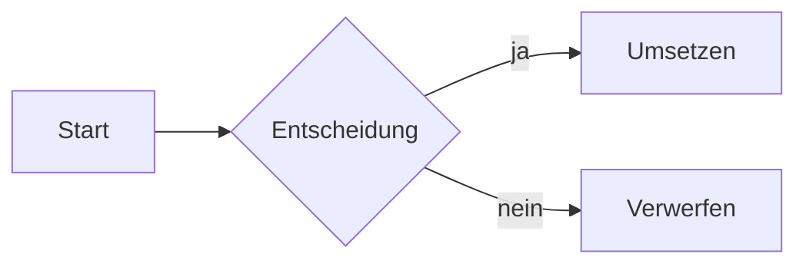
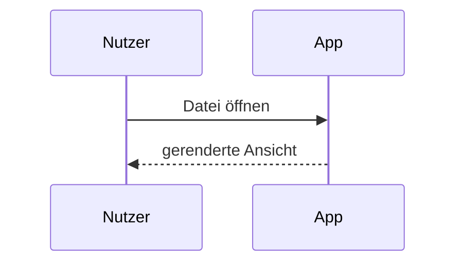
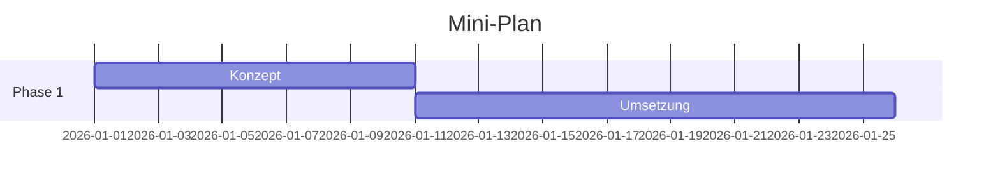
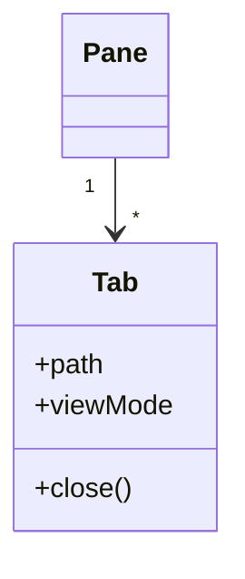
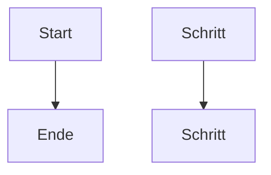

# Mathematik und Diagramme

Formeln setzt KaTeX, Diagramme rendert Mermaid, Code-Blöcke erhalten Syntax-Highlighting — alles in Lese-Ansicht, geteilter Ansicht und Live-Modus.

Diagramme aus den Werten einer Datentabelle beschreibt die eigene Seite [Diagramme zu Tabellen](charts.md).

## KaTeX inline

Formeln zwischen einfachen Dollar-Zeichen rendern im Fließtext. Eine Heuristik schützt Dollar-Beträge: `$100` im Satz bleibt Text, nur echte Formel-Paare werden gesetzt.

```markdown
Die Lösung ist $x = \frac{-b \pm \sqrt{b^2-4ac}}{2a}$ nach der Mitternachtsformel.
```

Die Lösung ist $x = \frac{-b \pm \sqrt{b^2-4ac}}{2a}$ nach der Mitternachtsformel.

## KaTeX als Block

Doppelte Dollar-Zeichen setzen eine abgesetzte, zentrierte Formel.

```markdown
$$
\sum_{i=1}^{n} i = \frac{n(n+1)}{2}
$$
```

$$
\sum_{i=1}^{n} i = \frac{n(n+1)}{2}
$$

## Mermaid

Code-Blöcke mit dem Sprach-Tag `mermaid` rendern als SVG-Diagramm und folgen dem Theme. Die gängigen Typen:

### Flowchart

````markdown

````


### Sequence



### Gantt



### Class



### Bausteine einfügen

Diagramme lassen sich zusammenklicken, statt die Schreibweise auswendig zu kennen. Drei Wege führen zum selben Angebot: der Aufklapp-Knopf **Mermaid-Diagramm** am Ende der [Format-Toolbar](toolbar.md), **Einfügen → Mermaid-Diagramm** im [Editor-Kontextmenü](context-menu.md) und das Kommando **Mermaid-Diagramm…** in der Kommando-Palette. Was angeboten wird, richtet sich nach der Lage der Schreibmarke:

- **Außerhalb jedes Code-Blocks** die vier Gerüste **Ablauf (Flowchart)**, **Abfolge (Sequence)**, **Zeitplan (Gantt)** und **Klassen (Class)**; jedes setzt einen vollständigen, gültigen Block.
- **Innerhalb eines Mermaid-Blocks** die Bausteine seiner Art: bei Ablauf **Knoten**, **Verzweigung**, **Verbindung** und **Beschriftete Verbindung**; bei Abfolge **Teilnehmer**, **Nachricht**, **Antwort**, **Schleife** und **Alternative**; bei Zeitplan **Abschnitt**, **Aufgabe** und **Meilenstein**; bei Klassen **Klasse**, **Klasse mit Mitgliedern**, **Vererbung**, **Beziehung** und **Teil von**.
- **In einem anderen Code-Block, auf der ersten oder letzten Zeile eines Mermaid-Blocks (den Zeilen mit den drei Backticks), in einem Mermaid-Block ohne Kopfzeile mit der Diagramm-Art (etwa `flowchart TD`) oder in einem Mermaid-Block einer anderen Diagramm-Art** steht nur der ausgegraute Hinweis «Keine Mermaid-Bausteine an dieser Stelle».

Neue Elemente bekommen fortlaufende Kennungen (`N1`, `N2` …), und ein verbindender Baustein wie Verbindung, Nachricht oder Vererbung bezieht sich auf die beiden zuletzt angelegten Elemente. Ein Baustein übernimmt die Einrückung der Zeile, in der die Schreibmarke steht. Nach dem Einfügen ist der erste Platzhalter ausgewählt und kann sofort überschrieben werden; ein Klick ist ein einziger Rückgängig-Schritt. Zwei Knoten und eine Verbindung im Ablauf-Gerüst ergeben zum Beispiel:



Im Live-Modus wird ein frisch eingefügtes Gerüst gezeichnet, sobald die Schreibmarke den Block verlässt.

Die Bausteine gehören zur [internen Erweiterung](extensions.md) «Mermaid-Diagramme», die ab dem Arbeitsmodus **Fortgeschritten** eingeschaltet ist. Ist sie aus, entfallen Knopf, Kontextmenü-Eintrag und Kommando. Wer die Belegung der Format-Toolbar angepasst hat, bekommt den Knopf nicht von selbst; wie er hinzukommt, steht auf der Seite [Format-Toolbar](toolbar.md) im Abschnitt «Belegung anpassen».

## Code-Blöcke mit Syntax-Highlighting

Ein Sprach-Tag hinter den öffnenden Backticks aktiviert die Farbpalette (folgt dem Theme):

````markdown
```javascript
function greet(name) {
  return `Hallo, ${name}!`;
}
```
````

```javascript
function greet(name) {
  return `Hallo, ${name}!`;
}
```

Der Copy-Button rechts oben am Block kopiert den Inhalt in die Zwischenablage — auch hier im Handbuch.

## Export

- **PDF-Export**: Diagramme werden als gerenderte Vektorgrafik gedruckt und dafür hell neu gezeichnet; Formeln und Code-Hervorhebung erscheinen wie in der Vorschau.
- **Portables Markdown**: Der Export brennt das Diagramm als fertiges Bild in die Datei ein — der Empfänger sieht es, ohne dieses Programm zu besitzen. Gezeichnet wird immer hell, unabhängig davon, in welchem Farbschema Sie arbeiten. Ein Diagramm mit fehlerhaftem Quelltext bleibt unverändert als Code-Block stehen, damit Sie den Quelltext nicht verlieren; dasselbe gilt bei ausgeschalteter Erweiterung «Mermaid-Diagramme». Das Diagramm steht als Bild mit eingebetteter Adresse in der Datei; Voraussetzung ist ein Markdown-Betrachter, der eingebettetes HTML und solche Bilder darstellt — für das HTML dieselbe Voraussetzung wie bei den exportierten Perspective-Tabellen. KaTeX-Formeln und Code-Blöcke mit Sprach-Tag sind gewöhnliche Markdown-Syntax und bleiben davon unberührt.
