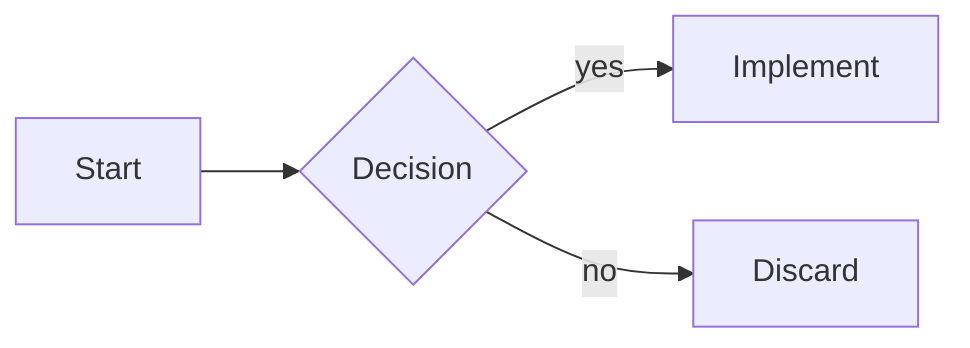
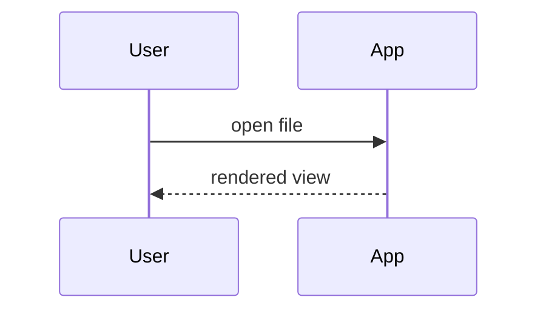
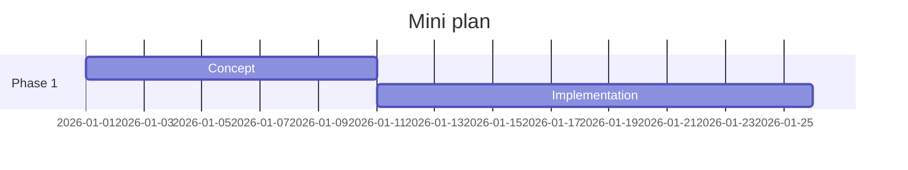
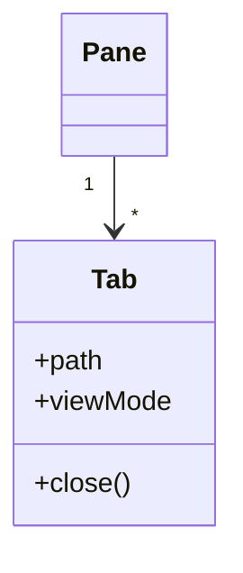
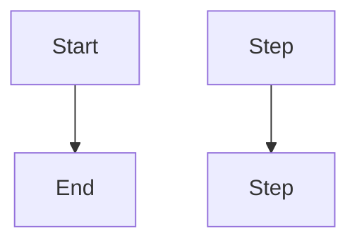

# Math and diagrams

KaTeX typesets formulas, Mermaid renders diagrams, code blocks get syntax highlighting — in Reading view, split view and Live mode alike.

Charts drawn from the values of a data table have a page of their own: [Charts for tables](charts.md).

## KaTeX inline

Formulas between single dollar signs render within running text. A heuristic protects dollar amounts: `$100` in a sentence stays text, only real formula pairs are typeset.

```markdown
The solution is $x = \frac{-b \pm \sqrt{b^2-4ac}}{2a}$ by the quadratic formula.
```

The solution is $x = \frac{-b \pm \sqrt{b^2-4ac}}{2a}$ by the quadratic formula.

## KaTeX as a block

Double dollar signs typeset a standalone, centred formula.

```markdown
$$
\sum_{i=1}^{n} i = \frac{n(n+1)}{2}
$$
```

$$
\sum_{i=1}^{n} i = \frac{n(n+1)}{2}
$$

## Mermaid

Code blocks with the `mermaid` language tag render as SVG diagrams and follow the theme. The common types:

### Flowchart

````markdown

````


### Sequence



### Gantt



### Class



### Inserting building blocks

Diagrams can be assembled by clicking instead of knowing the notation by heart. Three ways lead to the same offer: the drop-down button **Mermaid diagram** at the end of the [format toolbar](toolbar.md), **Insert → Mermaid diagram** in the [editor context menu](context-menu.md) and the command **Mermaid diagram…** in the command palette. What is offered depends on where the cursor is:

- **Outside any code block** the four skeletons **Flow (Flowchart)**, **Sequence (Sequence)**, **Schedule (Gantt)** and **Classes (Class)**; each one inserts a complete, valid block.
- **Inside a Mermaid block** the building blocks of its type: for a flow **Node**, **Decision**, **Connection** and **Labeled connection**; for a sequence **Participant**, **Message**, **Reply**, **Loop** and **Alternative**; for a schedule **Section**, **Task** and **Milestone**; for classes **Class**, **Class with members**, **Inheritance**, **Association** and **Part of**.
- **In another code block, on the first or last line of a Mermaid block (the lines with the three backticks), in a Mermaid block without a header line naming the diagram type (such as `flowchart TD`) or in a Mermaid block of another diagram type** only the greyed-out hint «No Mermaid building blocks at this position» appears.

New elements get consecutive identifiers (`N1`, `N2` …), and a joining building block such as connection, message or inheritance refers to the two most recently added elements. A building block takes over the indentation of the line the cursor is on. After inserting, the first placeholder is selected and can be overwritten at once; one click is a single undo step. Two nodes and a connection in the flow skeleton, for example, result in:



In Live mode a freshly inserted skeleton is drawn as soon as the cursor leaves the block.

The building blocks belong to the [internal extension](extensions.md) «Mermaid diagrams», which is switched on from the working mode **Advanced**. When it is off, the button, the context menu entry and the command are gone. If you have customized the assignment of the format toolbar, the button is not added automatically; the section «Customize the assignment» on the [format toolbar](toolbar.md) page explains how to add it.

## Code blocks with syntax highlighting

A language tag after the opening backticks enables the colour palette (follows the theme):

````markdown
```javascript
function greet(name) {
  return `Hello, ${name}!`;
}
```
````

```javascript
function greet(name) {
  return `Hello, ${name}!`;
}
```

The copy button at the top right of the block copies the content to the clipboard — here in the manual too.

## Export

- **PDF export**: diagrams are printed as rendered vector graphics, redrawn in light colors for print; formulas and code highlighting appear as in the preview.
- **Portable Markdown**: the export burns the diagram into the file as a finished image — the recipient sees it without owning this program. It is always drawn light, no matter which colour scheme you work in. A diagram with faulty source text is left untouched as a code block so that you do not lose the source; the same applies when the «Mermaid diagrams» extension is switched off. The diagram sits in the file as an image with an embedded address; this requires a Markdown viewer that renders embedded HTML and such images — for the HTML the same requirement as for exported Perspective tables. KaTeX formulas and code blocks with a language tag are ordinary Markdown syntax and remain unaffected.
