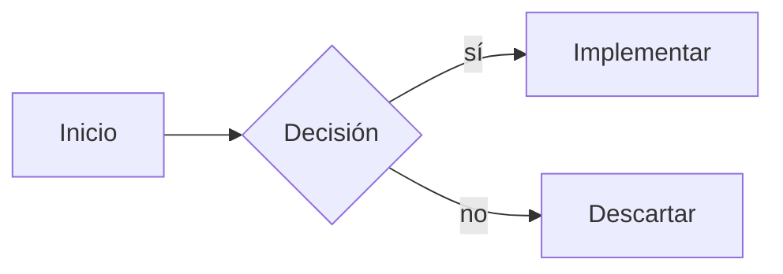
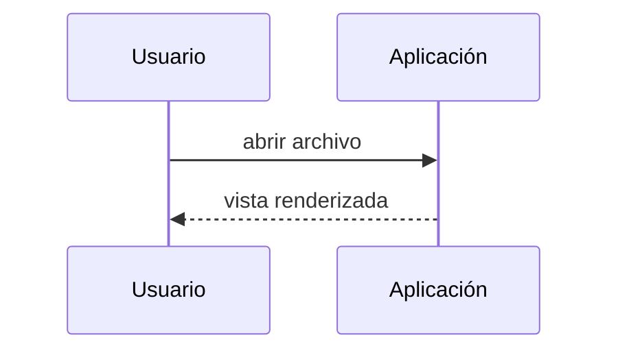
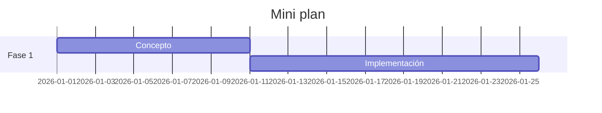
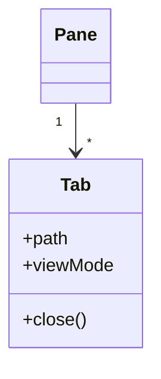
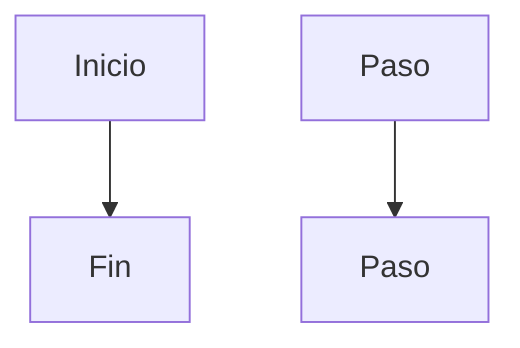

# Matemáticas y diagramas

KaTeX compone las fórmulas, Mermaid renderiza los diagramas, los bloques de código reciben resaltado de sintaxis — en la vista Lectura, la vista dividida y el modo En vivo.

Los gráficos a partir de los valores de una tabla de datos tienen su propia página: [Gráficos de tablas](charts.md).

## KaTeX en línea

Las fórmulas entre signos de dólar simples se renderizan en el texto corriente. Una heurística protege los importes en dólares: `$100` en una frase queda como texto, solo los pares de fórmulas reales se componen.

```markdown
La solución es $x = \frac{-b \pm \sqrt{b^2-4ac}}{2a}$ según la fórmula cuadrática.
```

La solución es $x = \frac{-b \pm \sqrt{b^2-4ac}}{2a}$ según la fórmula cuadrática.

## KaTeX como bloque

Los signos de dólar dobles componen una fórmula aislada y centrada.

```markdown
$$
\sum_{i=1}^{n} i = \frac{n(n+1)}{2}
$$
```

$$
\sum_{i=1}^{n} i = \frac{n(n+1)}{2}
$$

## Mermaid

Los bloques de código con la etiqueta `mermaid` se renderizan como diagramas SVG y siguen el tema. Los tipos habituales:

### Flowchart

````markdown

````


### Sequence



### Gantt



### Class



### Insertar bloques

Los diagramas se pueden montar con clics, sin conocer la sintaxis de memoria. Tres caminos llevan a la misma oferta: el botón desplegable **Diagrama Mermaid** al final de la [barra de formato](toolbar.md), **Insertar → Diagrama Mermaid** en el [menú contextual del editor](context-menu.md) y el comando **Diagrama Mermaid…** en la paleta de comandos. Lo que se ofrece depende de la posición del cursor:

- **Fuera de cualquier bloque de código**, los cuatro esqueletos **Flujo (Flowchart)**, **Secuencia (Sequence)**, **Cronograma (Gantt)** y **Clases (Class)**; cada uno inserta un bloque completo y válido.
- **Dentro de un bloque Mermaid**, los bloques de su tipo: en un flujo **Nodo**, **Decisión**, **Conexión** y **Conexión con etiqueta**; en una secuencia **Participante**, **Mensaje**, **Respuesta**, **Bucle** y **Alternativa**; en un cronograma **Sección**, **Tarea** e **Hito**; en clases **Clase**, **Clase con miembros**, **Herencia**, **Asociación** y **Parte de**.
- **En otro bloque de código, en la primera o la última línea de un bloque Mermaid (las líneas con los tres acentos graves), en un bloque Mermaid sin línea de cabecera con el tipo de diagrama (por ejemplo `flowchart TD`) o en un bloque Mermaid de otro tipo de diagrama** solo aparece la indicación atenuada «No hay bloques de Mermaid en esta posición».

Los elementos nuevos reciben identificadores consecutivos (`N1`, `N2` …), y un bloque de unión como conexión, mensaje o herencia se refiere a los dos elementos creados en último lugar. Un bloque adopta la sangría de la línea en la que está el cursor. Tras la inserción, el primer marcador de posición queda seleccionado y se puede sobrescribir enseguida; un clic es un único paso de deshacer. Dos nodos y una conexión en el esqueleto de flujo dan, por ejemplo:



En el modo En vivo, un esqueleto recién insertado se dibuja en cuanto el cursor sale del bloque.

Los bloques forman parte de la [extensión interna](extensions.md) «Diagramas Mermaid», que está activada a partir del modo de trabajo **Avanzado**. Si está desactivada, desaparecen el botón, la entrada del menú contextual y el comando. Si ha personalizado la asignación de la barra de formato, el botón no se añade por sí solo; la sección «Personalizar la asignación» de la página [Barra de formato](toolbar.md) explica cómo añadirlo.

## Bloques de código con resaltado de sintaxis

Una etiqueta de idioma tras los acentos graves de apertura activa la paleta de colores (sigue el tema):

````markdown
```javascript
function greet(name) {
  return `¡Hola, ${name}!`;
}
```
````

```javascript
function greet(name) {
  return `¡Hola, ${name}!`;
}
```

El botón de copia arriba a la derecha del bloque copia el contenido al portapapeles — también aquí en el manual.

## Exportación

- **Exportación a PDF**: los diagramas se imprimen como gráficos vectoriales renderizados, redibujados en claro para la impresión; las fórmulas y el resaltado de código aparecen como en la vista previa.
- **Markdown portable**: la exportación graba el diagrama en el archivo como imagen terminada: el destinatario lo ve sin tener este programa. Siempre se dibuja en claro, sea cual sea el esquema de color con el que trabaje. Un diagrama con texto fuente defectuoso permanece sin cambios como bloque de código, para que no pierda la fuente; lo mismo ocurre con la extensión «Diagramas Mermaid» desactivada. El diagrama figura en el archivo como una imagen con dirección incrustada; requiere un visor de Markdown que muestre HTML incrustado y ese tipo de imágenes: para el HTML, el mismo requisito que para las tablas Perspective exportadas. Las fórmulas KaTeX y los bloques de código con etiqueta de lenguaje son sintaxis Markdown corriente y no se ven afectados.
