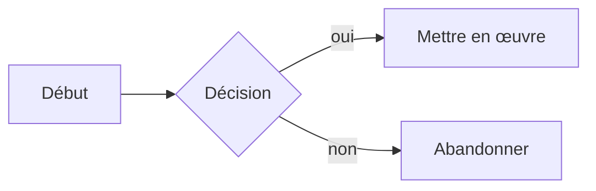
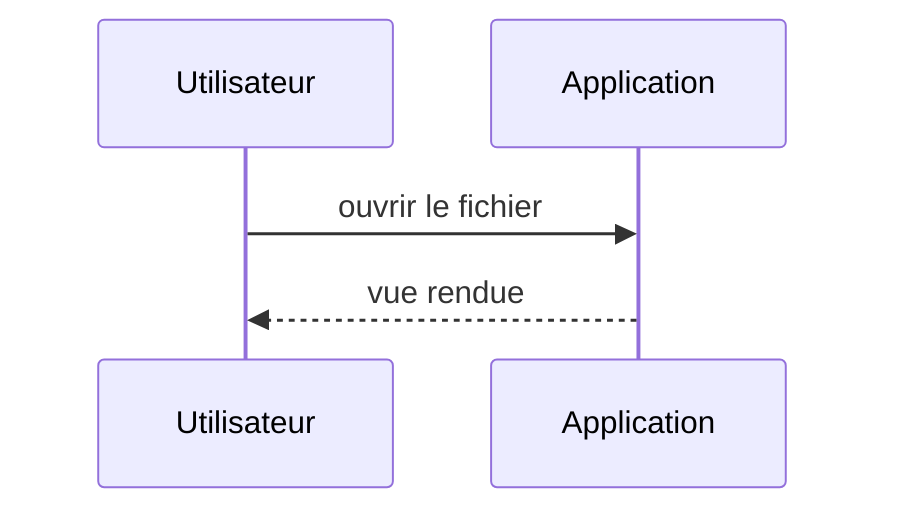
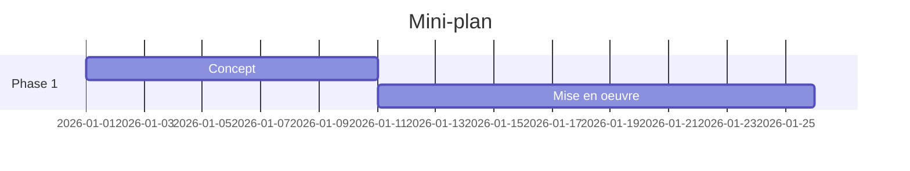
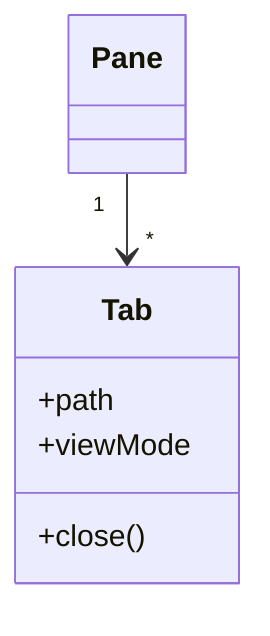
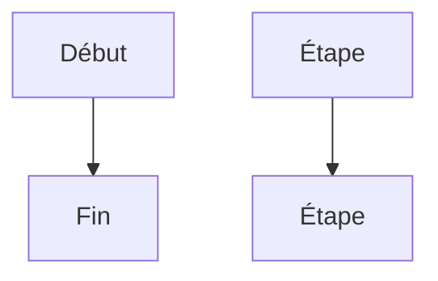

# Mathématiques et diagrammes

KaTeX compose les formules, Mermaid rend les diagrammes, les blocs de code reçoivent la coloration syntaxique — en vue Lecture, en vue scindée et en mode Direct.

Les graphiques tirés des valeurs d’une table de données ont leur propre page : [Graphiques de tables](charts.md).

## KaTeX en ligne

Les formules entre signes dollar simples se rendent dans le texte courant. Une heuristique protège les montants en dollars : `$100` dans une phrase reste du texte, seules les vraies paires de formules sont composées.

```markdown
La solution est $x = \frac{-b \pm \sqrt{b^2-4ac}}{2a}$ selon la formule quadratique.
```

La solution est $x = \frac{-b \pm \sqrt{b^2-4ac}}{2a}$ selon la formule quadratique.

## KaTeX en bloc

Les doubles signes dollar composent une formule isolée et centrée.

```markdown
$$
\sum_{i=1}^{n} i = \frac{n(n+1)}{2}
$$
```

$$
\sum_{i=1}^{n} i = \frac{n(n+1)}{2}
$$

## Mermaid

Les blocs de code avec la balise de langue `mermaid` se rendent en diagrammes SVG et suivent le thème. Les types courants :

### Flowchart

````markdown

````


### Sequence



### Gantt



### Class



### Insérer des éléments

Les diagrammes se composent par clics, sans connaître la syntaxe par cœur. Trois chemins mènent à la même offre : le bouton déroulant **Diagramme Mermaid** à la fin de la [barre de format](toolbar.md), **Insérer → Diagramme Mermaid** dans le [menu contextuel de l'éditeur](context-menu.md) et la commande **Diagramme Mermaid…** dans la palette de commandes. Ce qui est proposé dépend de la position du curseur :

- **En dehors de tout bloc de code**, les quatre structures **Déroulement (Flowchart)**, **Séquence (Sequence)**, **Planning (Gantt)** et **Classes (Class)** ; chacune insère un bloc complet et valide.
- **Dans un bloc Mermaid**, les éléments de son type : pour un déroulement **Nœud**, **Décision**, **Liaison** et **Liaison étiquetée** ; pour une séquence **Participant**, **Message**, **Réponse**, **Boucle** et **Alternative** ; pour un planning **Section**, **Tâche** et **Jalon** ; pour des classes **Classe**, **Classe avec membres**, **Héritage**, **Association** et **Fait partie de**.
- **Dans un autre bloc de code, sur la première ou la dernière ligne d'un bloc Mermaid (les lignes aux trois accents graves), dans un bloc Mermaid sans ligne d'en-tête indiquant le type de diagramme (par exemple `flowchart TD`) ou dans un bloc Mermaid d'un autre type de diagramme**, seule l'indication grisée « Aucun élément Mermaid à cet endroit » apparaît.

Les nouveaux éléments reçoivent des identifiants consécutifs (`N1`, `N2` …), et un élément de liaison comme liaison, message ou héritage se rapporte aux deux éléments créés en dernier. Un élément reprend l'indentation de la ligne où se trouve le curseur. Après l'insertion, le premier espace réservé est sélectionné et peut être remplacé aussitôt ; un clic correspond à une seule étape d'annulation. Deux nœuds et une liaison dans la structure de déroulement donnent par exemple :



En mode Direct, une structure fraîchement insérée est dessinée dès que le curseur quitte le bloc.

Les éléments font partie de l'[extension interne](extensions.md) « Diagrammes Mermaid », activée à partir du mode de travail **Avancé**. Si elle est désactivée, le bouton, l'entrée du menu contextuel et la commande disparaissent. Si vous avez personnalisé l'affectation de la barre de format, le bouton n'y est pas ajouté de lui-même ; la section « Personnaliser l'affectation » de la page [Barre de format](toolbar.md) explique comment l'ajouter.

## Blocs de code avec coloration syntaxique

Une balise de langue après les accents graves ouvrants active la palette de couleurs (suit le thème) :

````markdown
```javascript
function greet(name) {
  return `Bonjour, ${name} !`;
}
```
````

```javascript
function greet(name) {
  return `Bonjour, ${name} !`;
}
```

Le bouton de copie en haut à droite du bloc copie le contenu dans le presse-papiers — ici aussi dans le manuel.

## Export

- **Export PDF** : les diagrammes sont imprimés comme graphiques vectoriels rendus, redessinés en clair pour l'impression ; les formules et la coloration du code apparaissent comme dans l'aperçu.
- **Markdown portable** : l'export incorpore le diagramme dans le fichier sous forme d'image finie — le destinataire le voit sans posséder ce programme. Le dessin est toujours clair, quel que soit le schéma de couleurs dans lequel vous travaillez. Un diagramme au texte source erroné reste inchangé comme bloc de code, afin que vous ne perdiez pas la source ; il en va de même lorsque l'extension « Diagrammes Mermaid » est désactivée. Le diagramme figure dans le fichier comme une image à adresse incorporée ; cela suppose un lecteur Markdown qui affiche le HTML incorporé et de telles images — pour le HTML, la même condition que pour les tableaux Perspective exportés. Les formules KaTeX et les blocs de code avec balise de langue relèvent de la syntaxe Markdown ordinaire et ne sont pas concernés.
