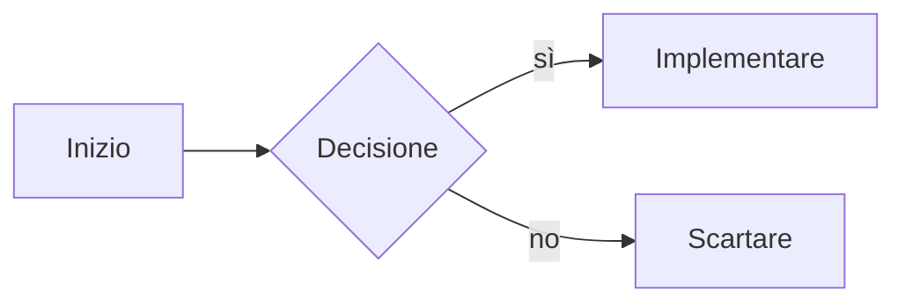
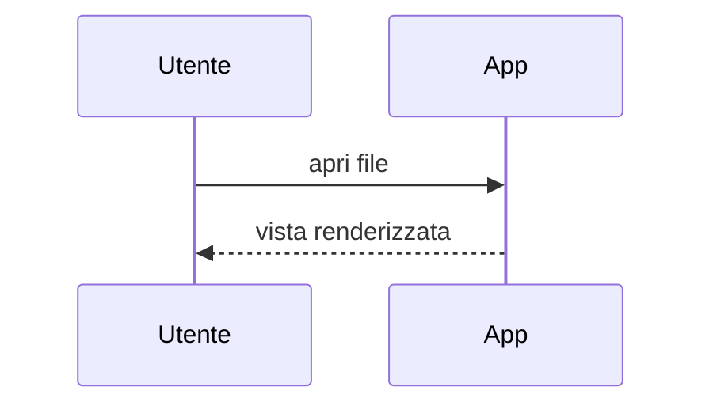
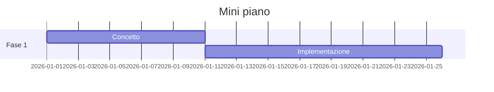
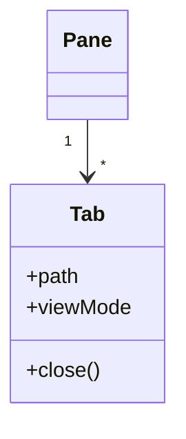
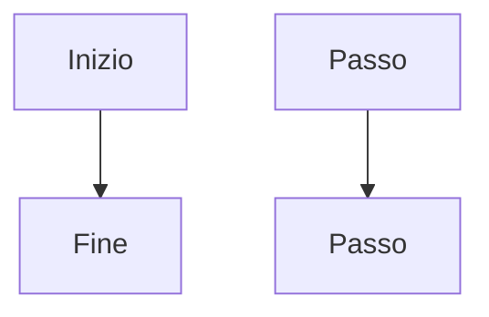

# Matematica e diagrammi

KaTeX compone le formule, Mermaid renderizza i diagrammi, i blocchi di codice ricevono l'evidenziazione della sintassi — nella vista Lettura, nella vista divisa e nella modalità Live.

I grafici ricavati dai valori di una tabella dati hanno una pagina propria: [Grafici di tabelle](charts.md).

## KaTeX in linea

Le formule tra segni di dollaro singoli si renderizzano nel testo corrente. Un'euristica protegge gli importi in dollari: `$100` in una frase resta testo, solo le vere coppie di formule vengono composte.

```markdown
La soluzione è $x = \frac{-b \pm \sqrt{b^2-4ac}}{2a}$ secondo la formula quadratica.
```

La soluzione è $x = \frac{-b \pm \sqrt{b^2-4ac}}{2a}$ secondo la formula quadratica.

## KaTeX come blocco

I doppi segni di dollaro compongono una formula isolata e centrata.

```markdown
$$
\sum_{i=1}^{n} i = \frac{n(n+1)}{2}
$$
```

$$
\sum_{i=1}^{n} i = \frac{n(n+1)}{2}
$$

## Mermaid

I blocchi di codice con il tag di lingua `mermaid` si renderizzano come diagrammi SVG e seguono il tema. I tipi comuni:

### Flowchart

````markdown

````


### Sequence



### Gantt



### Class



### Inserire blocchi

I diagrammi si possono comporre con pochi clic, senza conoscere a memoria la sintassi. Tre vie portano alla stessa offerta: il pulsante a discesa **Diagramma Mermaid** alla fine della [barra di formattazione](toolbar.md), **Inserisci → Diagramma Mermaid** nel [menu contestuale dell'editor](context-menu.md) e il comando **Diagramma Mermaid…** nella palette dei comandi. Ciò che viene offerto dipende dalla posizione del cursore:

- **Fuori da qualsiasi blocco di codice**, i quattro scheletri **Flusso (Flowchart)**, **Sequenza (Sequence)**, **Pianificazione (Gantt)** e **Classi (Class)**; ognuno inserisce un blocco completo e valido.
- **Dentro un blocco Mermaid**, i blocchi del suo tipo: per un flusso **Nodo**, **Decisione**, **Collegamento** e **Collegamento con etichetta**; per una sequenza **Partecipante**, **Messaggio**, **Risposta**, **Ciclo** e **Alternativa**; per una pianificazione **Sezione**, **Attività** e **Traguardo**; per le classi **Classe**, **Classe con membri**, **Ereditarietà**, **Associazione** e **Parte di**.
- **In un altro blocco di codice, sulla prima o sull'ultima riga di un blocco Mermaid (le righe con i tre accenti gravi), in un blocco Mermaid senza riga di intestazione con il tipo di diagramma (per esempio `flowchart TD`) o in un blocco Mermaid di un altro tipo di diagramma** compare solo l'indicazione in grigio «Nessun blocco Mermaid in questa posizione».

I nuovi elementi ricevono identificativi progressivi (`N1`, `N2` …), e un blocco di unione come collegamento, messaggio o ereditarietà si riferisce ai due elementi creati per ultimi. Un blocco riprende il rientro della riga in cui si trova il cursore. Dopo l'inserimento il primo segnaposto è selezionato e si può sovrascrivere subito; un clic è un unico passo di annullamento. Due nodi e un collegamento nello scheletro di flusso danno per esempio:



Nella modalità Live uno scheletro appena inserito viene disegnato non appena il cursore lascia il blocco.

I blocchi fanno parte dell'[estensione interna](extensions.md) «Diagrammi Mermaid», attiva a partire dalla modalità di lavoro **Avanzata**. Se è disattivata, scompaiono il pulsante, la voce del menu contestuale e il comando. Chi ha personalizzato l'assegnazione della barra di formattazione non riceve il pulsante da sé; la sezione «Personalizzare l'assegnazione» della pagina [Barra di formattazione](toolbar.md) spiega come aggiungerlo.

## Blocchi di codice con evidenziazione della sintassi

Un tag di lingua dopo gli accenti gravi di apertura attiva la palette di colori (segue il tema):

````markdown
```javascript
function greet(name) {
  return `Ciao, ${name}!`;
}
```
````

```javascript
function greet(name) {
  return `Ciao, ${name}!`;
}
```

Il pulsante di copia in alto a destra del blocco copia il contenuto negli appunti — anche qui nel manuale.

## Esportazione

- **Esportazione PDF**: i diagrammi vengono stampati come grafica vettoriale renderizzata, ridisegnata in chiaro per la stampa; formule ed evidenziazione del codice appaiono come nell'anteprima.
- **Markdown portabile**: l'esportazione imprime il diagramma nel file come immagine finita: il destinatario lo vede senza possedere questo programma. Viene sempre disegnato in chiaro, indipendentemente dallo schema di colori in cui lavorate. Un diagramma con testo sorgente errato resta invariato come blocco di codice, cosi da non perdere la sorgente; lo stesso vale con l'estensione «Diagrammi Mermaid» disattivata. Il diagramma figura nel file come immagine con indirizzo incorporato; richiede un visualizzatore Markdown che mostri l'HTML incorporato e immagini di questo tipo: per l'HTML, lo stesso requisito delle tabelle Perspective esportate. Le formule KaTeX e i blocchi di codice con tag di linguaggio sono sintassi Markdown ordinaria e non ne sono interessati.
